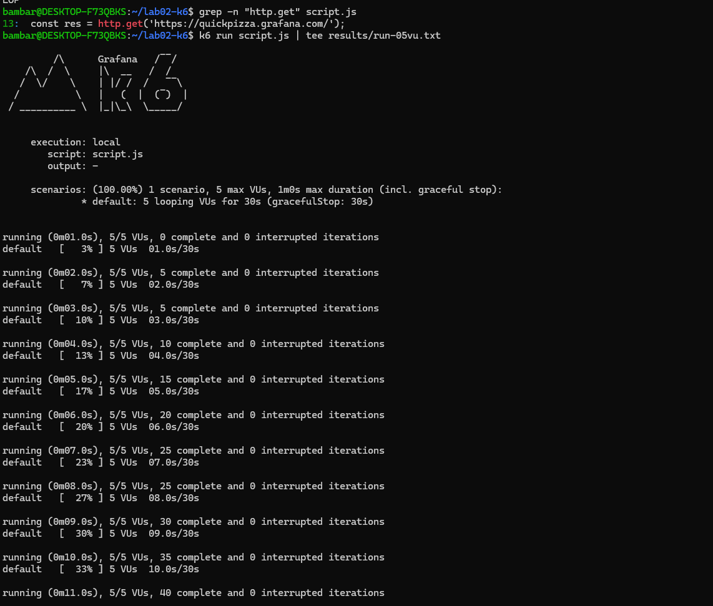
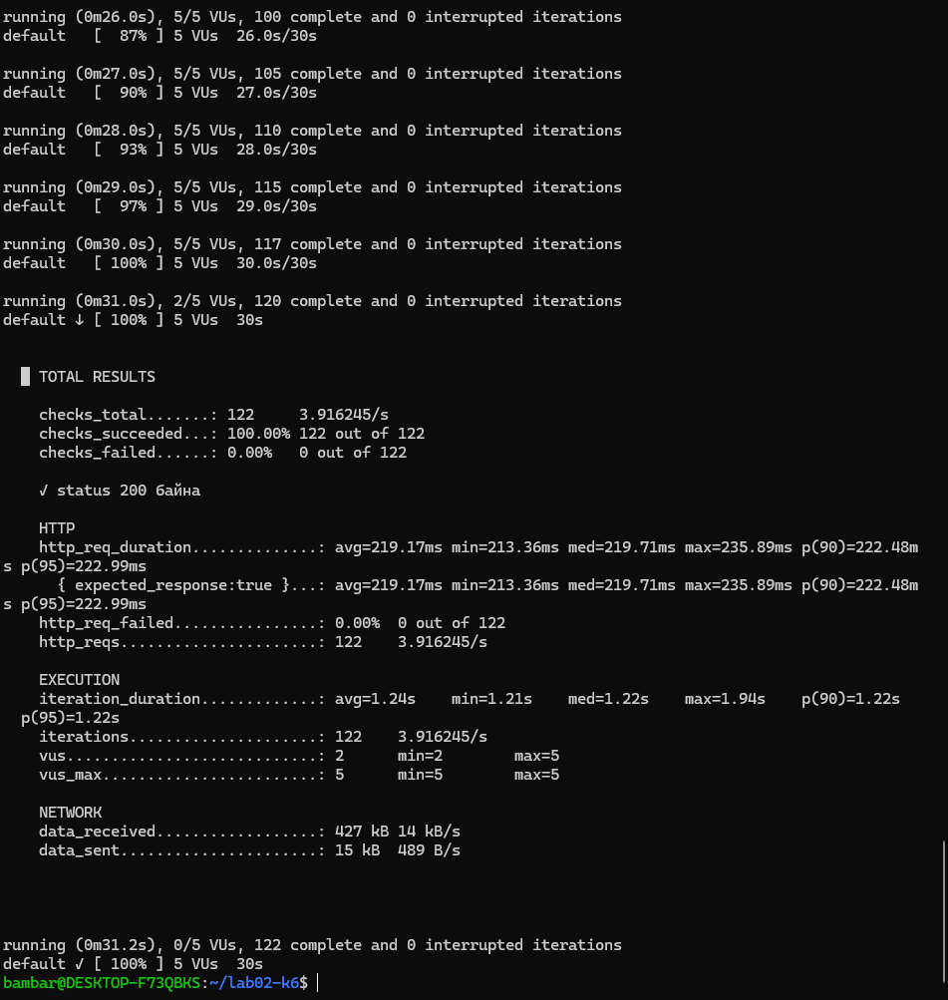
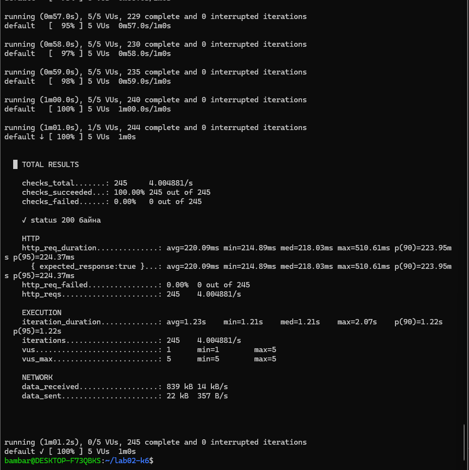
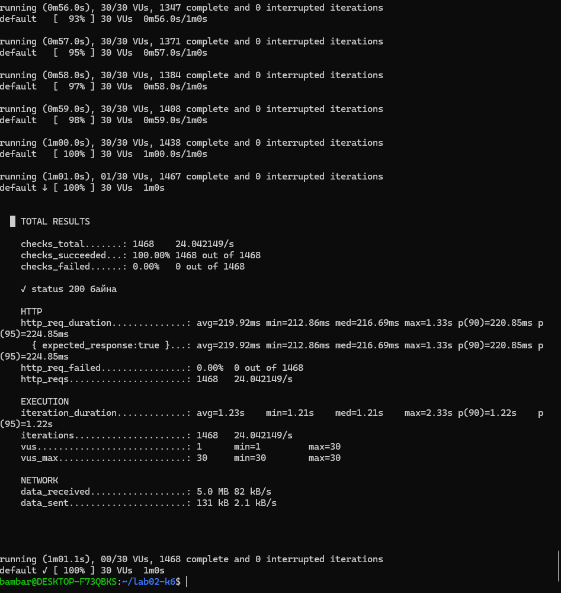
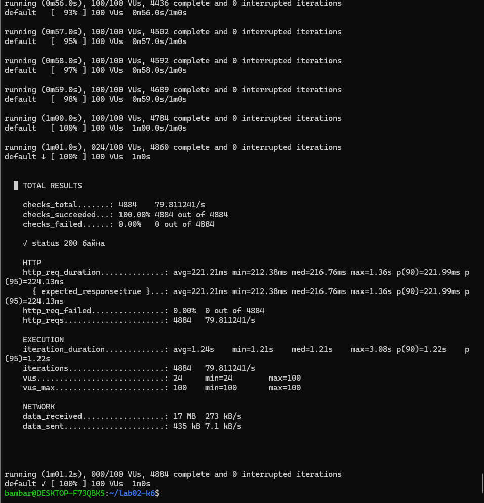
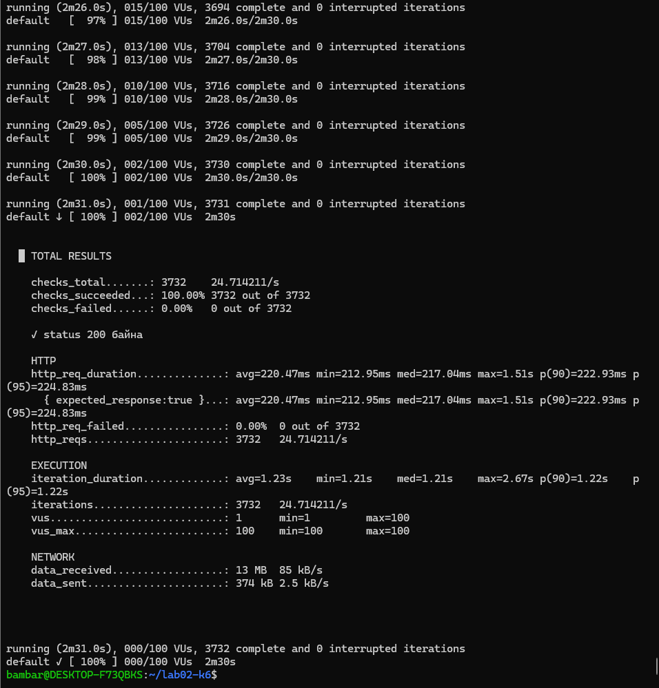
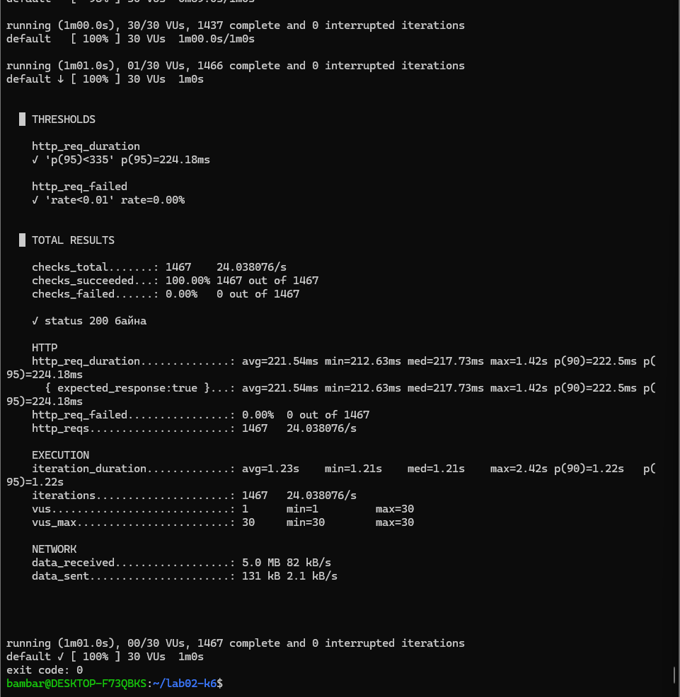
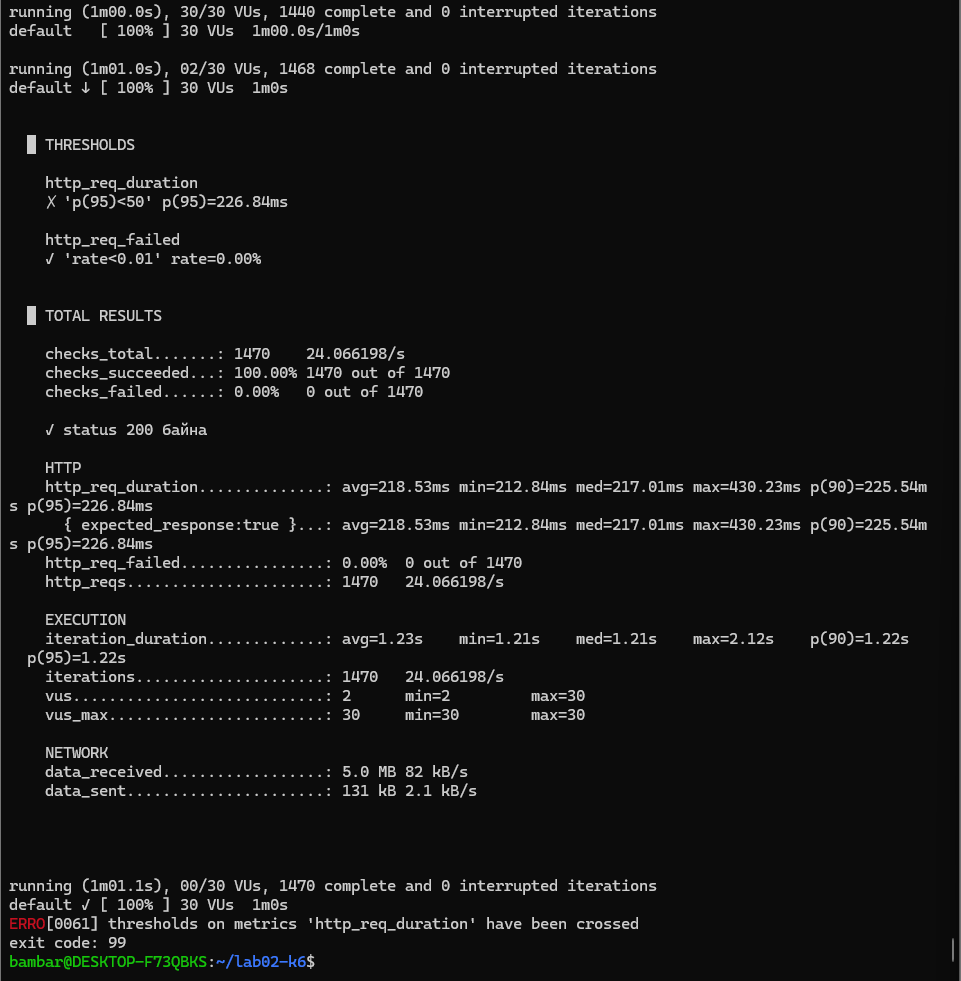

# Лаборатори №2: Гүйцэтгэлийн хэмжүүрийг k6-аар хэмжих

**F.CSA313: Программ хангамжийн чанарын баталгаа ба тест (2026)**
Оюутан: Б.Хишигцогзол (B222270834)

## Орчин

- Windows 11 + WSL2 (Ubuntu)
- k6 хувилбар (`results/k6-version.txt`):

      k6 v2.4.0 (commit/dd9395906d, go1.26.11, linux/amd64)

- Суулгах үед гарсан асуудал: зааврын GPG түлхүүр (`C5AD17C7...`) хуучирсан байсан, k6 репо одоо шинэ түлхүүрээр (`C780D0BDB1A69C86`) гарын үсэг зурдаг. Тиймээс `https://dl.k6.io/key.gpg`-ээс албан ёсны түлхүүрийг татаж суулгав.

## Тестийн бай (ёс зүй)

`https://test.k6.io` одоо `302` хариугаар `https://quickpizza.grafana.com/` руу шилжүүлдэг. Энэ нь Grafana k6-ийн test.k6.io-г орлосон албан ёсны дадлагын сайт. Redirect-ийн нэмэлт хүсэлт хэмжилтэд холилдохгүйн тулд (давталт бүрт 2 хүсэлт явж, `http_reqs`, `http_req_duration` гажихаас сэргийлж) эцсийн хаягийг шууд ашиглав. Өөр ямар ч сайт руу тест хийгээгүй.

## Файлууд

| Файл | Зориулалт |
|------|-----------|
| `script.js` | Үндсэн тест (stages-гүй). Baseline болон 5/30/100 VU хэмжилт |
| `stages.js` | 5→30→100→0 VU шатлалт |
| `threshold.js` | SLO threshold (`-e P95=...`-ээр босгыг солих боломжтой) |
| `results/*.txt` | k6-ийн бүтэн текст гаралт |
| `screenshots/*.png` | Summary-гийн дэлгэцийн зургууд |

## Алхам 2: Baseline (5 VU, 30s)

Эх файл: `results/baseline-05vu-30s.txt`

| avg | p90 | p95 | Throughput | Error rate |
|-----|-----|-----|------------|------------|
| 219.17 ms | 222.48 ms | **222.99 ms** | 122 хүсэлт, 3.92/s | 0.00% (0/122) |

## Алхам 3: Ачааллын гурван түвшин (тус бүр 1 минут)

Эх файлууд: `results/run-05vu.txt`, `results/run-30vu.txt`, `results/run-100vu.txt`

| VU | p90 | p95 | max | Throughput (нийт, /s) | Error rate |
|----|-----|-----|-----|-----------------------|------------|
| 5 | 223.95 ms | 224.37 ms | 510.61 ms | 245, 4.00/s | 0.00% |
| 30 | 220.85 ms | 224.85 ms | 1.33 s | 1468, 24.04/s | 0.00% |
| 100 | 221.99 ms | 224.13 ms | 1.36 s | 4884, 79.81/s | 0.00% |

**Stages** (`results/run-stages.txt`): нэгтгэсэн summary нь p95=224.83 ms, 3732 хүсэлт, **24.71/s** гарсан. Энэ 24.71/s нь бүх шатны дундаж учраас 100 VU-ийн оргил үеийн 79.81/s харагдахгүй. Тиймээс түвшин тус бүрийг тусад нь хэмжсэн.

## Алхам 4: Thresholds (SLO)

**SLO-г сонгосон үндэслэл:** baseline p95 = 222.99 ms × 1.5 ≈ **335 ms**. 1.5 дахин нь сүлжээний хэвийн хэлбэлзэлд (5 VU-д ч max 510 ms хүрсэн) зай үлдээх боловч хэрэглэгчдийн 5%-иас дээш хүн мэдрэх бодит удаашралыг барина. Error rate-ийн SLO нь **< 1%**.

| Ажиллуулалт | Босго | Бодит p95 | Үр дүн | Exit code | Эх файл |
|-------------|-------|-----------|--------|-----------|---------|
| PASS | `p(95)<335` | 224.18 ms | ✓ | 0 | `results/threshold-pass.txt` |
| FAIL (санаатай) | `p(95)<50` | 226.84 ms | ✗ | 99 | `results/threshold-fail.txt` |

FAIL ажиллуулалтад **checks 100% амжилттай** байсан ч тест унасан. `check` нь хариу зөв эсэхийг, `threshold` нь хангалттай хурдан эсэхийг шалгадаг. 0-ээс өөр exit code (99)-ийг CI pipeline алдаа гэж үзээд build-ийг зогсооно. Quality gate гэдэг нь энэ.

## Дүгнэлт

1. Ачааллыг 5-аас 100 VU хүртэл 20 дахин өсгөхөд throughput 4.00/s-ээс 79.81/s болж бараг яг 20 дахин өссөн. Систем энэ хүрээнд шугаман масштабтай ажилласан.
2. Throughput-ийг сервер биш, `sleep(1)` think time хязгаарласан: давталт бүр ~1.23 s (хүсэлт ~0.22 s + 1 s хүлээлт) үргэлжилсэн тул throughput ≈ VU ÷ 1.23 s болсон.
3. p95 latency гурван түвшинд 224.13–224.85 ms-ийн хооронд, бараг өөрчлөгдөөгүй. Иймд лекцийн "хэрэглэгч олшрох тусам хариу удаашрах" зөрчил p95 түвшинд энэ ачаалалд илрээгүй. QuickPizza бол CDN дээр ажилладаг сайт тул 100 VU түүнд бага ачаалал юм.
4. Харин муудал **сүүлийн хэсэгт (tail latency)** илэрсэн: max 510 ms-ээс 1.33–1.36 s болж, iteration_duration-ийн max 3.08 s хүрсэн. "Нэгж хэрэглэгчийн туршлага" 30 VU-ээс эхлэн цөөн хэрэглэгчийн хувьд муудаж эхэлсэн гэж дүгнэв.
5. Энэ нь лекцэд үзсэн дундаж (avg) биш перцентиль (p95/p99) ашиглах шаардлагыг баталж байна. avg бараг өөрчлөгдөөгүй (219–221 ms) ч цөөн хэрэглэгч 6 дахин удаан хүлээсэн.
6. Бүх түвшинд error rate 0.00% байсан. Лекцийн POFOD-ийн аналогоор илэрхийлбэл 7,000 гаруй хүсэлтэд нэг ч алдаа гараагүй, availability бүрэн хангагдсан.
7. Stages туршилтаас нэгтгэсэн summary оргил ачааллыг "дундажлаад" нуудаг болохыг харсан. Тиймээс түвшин бүрийг тусад нь хэмжих шаардлагатай.
8. Миний SLO (p95 < 335 ms, error rate < 1%) baseline-д үндэслэсэн бөгөөд 30 VU-д p95=224.18 ms, алдаа 0% гарч **хангагдсан**.
9. Санаатай хатуу босго (p95 < 50 ms) нь exit code 99-өөр FAIL болсон нь threshold-ийг CI-д quality gate болгон ашиглаж болохыг харуулав.
10. Гадаад сүлжээн дээрх хэмжилт TLS, сүлжээний хоцрогдлоос хамаардаг (min ~212 ms). Системийн өөрийн хязгаарыг олохын тулд локал сервер дээр (Алхам 5) хэмжих нь дараагийн алхам байх юм.
